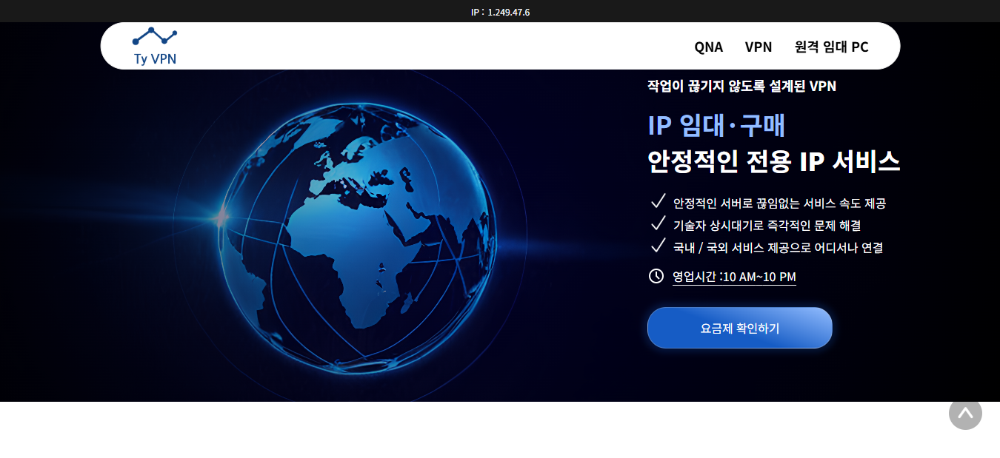
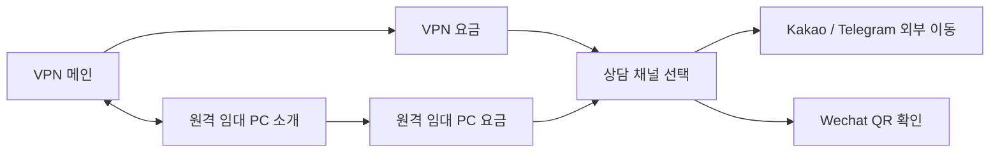
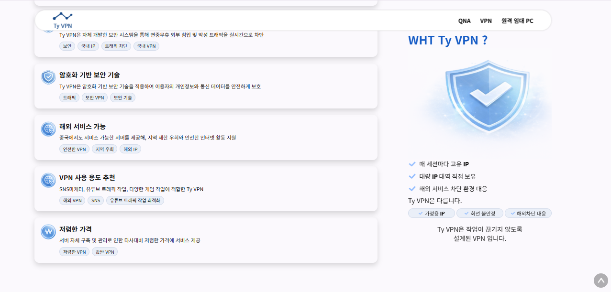
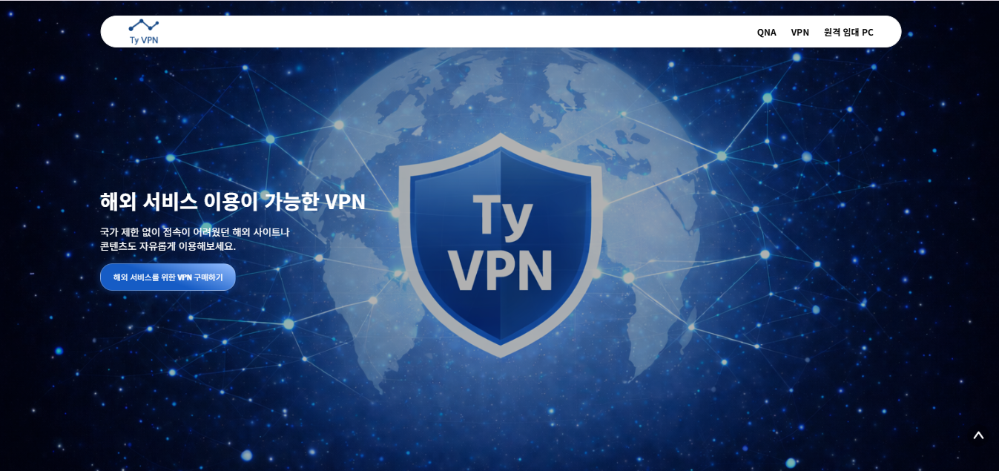
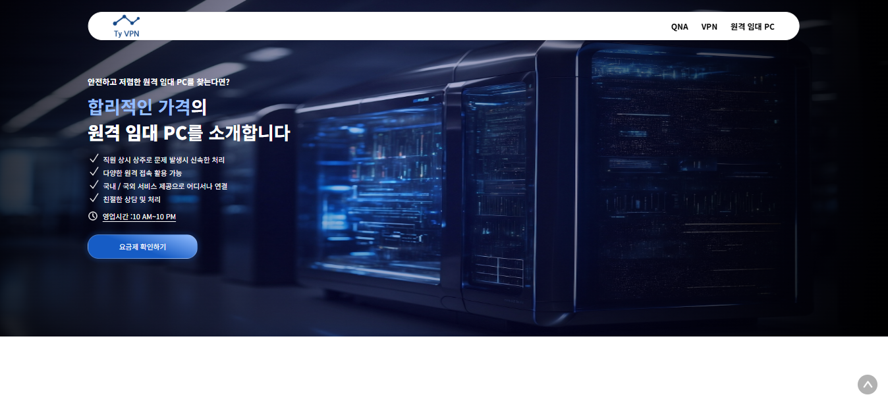
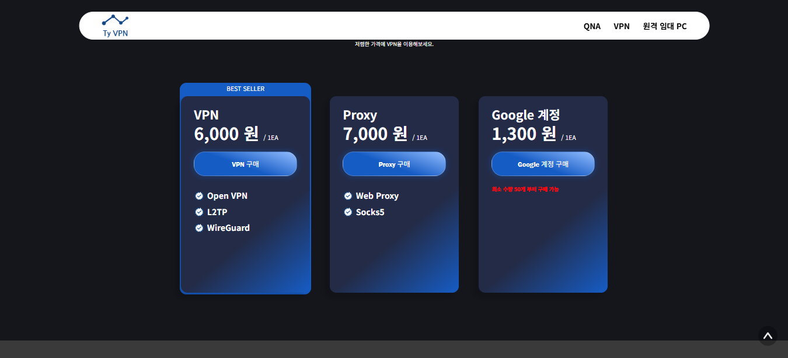

# TYVPN 3.0

### 서비스 소개부터 요금제 비교와 상담 연결까지

**Next.js · React · TypeScript · SCSS Modules · Cloudflare Pages Functions**

[서비스 웹사이트](https://tyvpn.kr/) · [원본 소스](https://github.com/saintlucias/TYVPN) · [화면 갤러리](docs/SCREENS.md) · [기능 상세](docs/FEATURES.md) · [인터랙션 효과](docs/INTERACTIONS.md)

## 프로젝트 소개

VPN·전용 IP와 원격 임대 PC 서비스를 소개하고, 방문자가 **서비스 이해 → 요금제 비교 → 상담 채널 선택**으로 이동할 수 있도록 구성한 프로젝트

VPN과 원격 임대 PC의 소개·가격 화면을 각각 제공하며, 긴 랜딩 페이지에 스크롤 인터랙션과 고정 콘텐츠를 배치함. 상품 카드, FAQ, 상담 모달은 공통 컴포넌트로 구성하고, 검색·공유를 위한 페이지별 메타데이터와 구조화 데이터를 작성함.

## 구현 목표와 기대 효과

| 방문자가 겪을 수 있는 문제 | 구현한 내용 | 기대 효과 |
| --- | --- | --- |
| VPN과 임대 PC의 차이, 이용 경로를 찾기 어려움 | 서비스별 소개 페이지와 요금 페이지 분리 | 관심 서비스의 정보에 순서대로 접근 |
| 긴 소개 페이지에서 핵심 내용을 놓침 | Sticky 설명 영역, 스크롤에 따른 3개 콘텐츠 전환 | 주요 메시지를 단계별로 전달 |
| 가격·사양·제공 항목을 각각 확인해야 함 | 상품별 요금 카드, PC 사양 카드, 품절 상태 표시 | 같은 형식으로 상품 조건 비교 |
| 요금 확인 후 문의 방법을 다시 찾아야 함 | 구매 버튼에서 Kakao·Telegram·Wechat 상담 모달 연결 | 가격 확인에서 문의까지 동선 연결 |
| 구매·연장·이용 조건에 대한 질문이 반복됨 | VPN·임대 PC별 FAQ 아코디언 | 상담 전 기본 정보 확인 지원 |
| 검색 결과와 링크 공유에 페이지 맥락이 부족함 | 페이지별 제목·설명·Canonical·OG·JSON-LD | 검색 엔진과 공유 서비스에 문서 정보 전달 |

## 주요 구현 기능

| 구분 | 구현 내용 |
| --- | --- |
| 서비스 소개 | VPN·전용 IP 랜딩, 원격 임대 PC 랜딩, 서비스별 배너와 CTA |
| 요금·상품 비교 | VPN 요금 카드 3종, 임대 PC 사양·가격 카드 5종, 추천·품절 표시 |
| 상담 연결 | Kakao·Telegram 외부 링크, Wechat QR 모달, 모달 바깥 클릭 닫기 |
| FAQ | VPN 12개·임대 PC 8개 문항, 질문별 독립적인 열기·닫기 |
| 탐색 | 공통 내비게이션, QNA 앵커, 요금 페이지 이동, 부드러운 맨 위 이동 |
| 스크롤 효과 | 좌우 커튼 개방, Sticky 요약, 3단계 콘텐츠 전환, 내비게이션 표시·숨김 |
| CSS 애니메이션 | 소개 영역의 파동·점멸 효과, 버튼·카드 전환 스타일 |
| IP 표시 | 메인에서 `/api/ip` 조회, Cloudflare 요청 헤더 기반 IP 응답 |
| 반응형 스타일 | 1279px·839px 기준 레이아웃·글자·이미지 크기 조정 |
| SEO | 페이지별 Metadata, Open Graph·Twitter 카드, JSON-LD, sitemap·robots |

IP 표시는 요청 IP를 보여주는 기능입니다. IPv6 형태를 구분해 `미보호` 문구를 표시하는 현재 로직은 실제 VPN 연결 여부나 보안 상태를 검사하지 않음.

## 웹페이지 구성

| 화면 | 경로 | 주요 구성 |
| --- | --- | --- |
| VPN 메인 | `/` | IP 바, 히어로, 소개 애니메이션, 요금 CTA, 장점 카드, 스크롤 전환, FAQ |
| 원격 임대 PC | `/Rental-PC` | 히어로, 이미지·텍스트 교차 배치, PC 사양 카드, FAQ |
| VPN 요금 | `/price/vpn` | 상품·가격·제공 항목 비교, 상담 모달 |
| 원격 임대 PC 요금 | `/price/rental-pc` | 월 요금·CPU·GPU·RAM·SSD 비교, 품절 표시, 상담 모달 |

### 서비스 소개와 시각 효과

VPN 메인은 파란색 계열의 브랜드 컬러와 대형 배경 이미지로 서비스를 소개함. 장점 목록 옆에 요약 영역을 고정하고, 이후에는 스크롤 진행률에 맞춰 이미지·설명·버튼을 함께 전환함.

### 원격 임대 PC 소개

VPN과 다른 배너·소개 구성을 사용하면서 공통 탐색과 버튼 스타일을 유지함. PC의 사양과 월 이용료를 카드로 나열하고 요금 페이지로 연결함.

### 요금제 비교

VPN 상품은 가격과 제공 항목을, 임대 PC는 하드웨어 사양과 월 요금을 비교할 수 있음. 구매 버튼은 상담 채널 선택 화면을 오픈함.

전체 **19개 화면 이미지**와 화면별 설명은 [화면 갤러리](docs/SCREENS.md)에 정리했음. 캡처는 원본 저장소의 기존 자료를 사용했으며, 촬영일은 확인되지 않았음. 가격·상품 상태·일부 문구는 현재 서비스와 다를 수 있음.

## 기술 구성과 설계

| 영역 | 기술·구성 | 적용 내용 |
| --- | --- | --- |
| 프레임워크 | Next.js 16.2.9, App Router | 4개 페이지, 공통 레이아웃, Metadata |
| UI | React 19.2.1, TypeScript 5.9.3 | 컴포넌트·상품 타입, 모달·FAQ 상태 관리 |
| 스타일 | Sass 1.94.2, SCSS Modules | 컴포넌트 스타일 분리, 공통 색상·반응형 기준 |
| 인터랙션 | 커스텀 훅, CSS animation·transition | 스크롤 이벤트, 진행률 계산, Sticky·파동 효과 |
| 배포 구성 | `output: "export"` | HTML·CSS·JS 정적 출력 |
| 요청 처리 | Cloudflare Pages Functions | 요청 헤더에서 IP를 읽는 별도 `/api/ip` 핸들러 |
| 검색·공유 | Metadata, JSON-LD, sitemap, robots | 문서·서비스·FAQ 정보 제공 |

버전은 원본 `package-lock.json` 기준임. 정적 페이지와 요청 시점의 IP 조회를 분리한 구성이고, IP 조회는 Cloudflare Functions 실행 환경이 필요함.

설계에서 다룬 내용은 다음과 같음.

- **서비스별 화면 분리:** 소개와 요금을 별도 경로로 나누면서 공통 헤더·푸터를 재사용함.
- **데이터와 표현 분리:** 상품·사양·FAQ·상담 채널을 타입이 있는 배열로 정의하고 공통 UI에 전달함.
- **스크롤 동작 분리:** 커튼·현재 콘텐츠 인덱스·내비게이션 상태를 커스텀 훅에서 계산합니다. 커튼·콘텐츠 전환 훅은 `requestAnimationFrame`으로 이벤트 갱신을 조절함.
- **검색 정보의 공통화:** `createPageMetadata`로 페이지별 제목·설명·URL·공유 이미지를 구성하고 FAQ 데이터로 구조화 데이터를 생성함.

[기술 설계와 코드 근거](docs/ARCHITECTURE.md) · [인터랙션 구현 상세](docs/INTERACTIONS.md)

## 구현 범위와 확인 기준

이 포트폴리오는 **서비스 소개·요금 안내·상담 유도 웹사이트**의 구현을 다룸. VPN 터널·암호화 엔진·트래픽 차단 시스템, 원격 제어 프로그램, 결제·주문·회원 관리 기능은 확인한 소스의 구현 범위에 포함되지 않음. 화면에 등장하는 보안·속도·서비스 제공 문구는 상품 소개 콘텐츠임.

---

[기능 상세](docs/FEATURES.md) · [화면 갤러리](docs/SCREENS.md) · [인터랙션 효과](docs/INTERACTIONS.md) · [기술 설계](docs/ARCHITECTURE.md) · [출처·검증 범위](docs/SOURCE.md)
