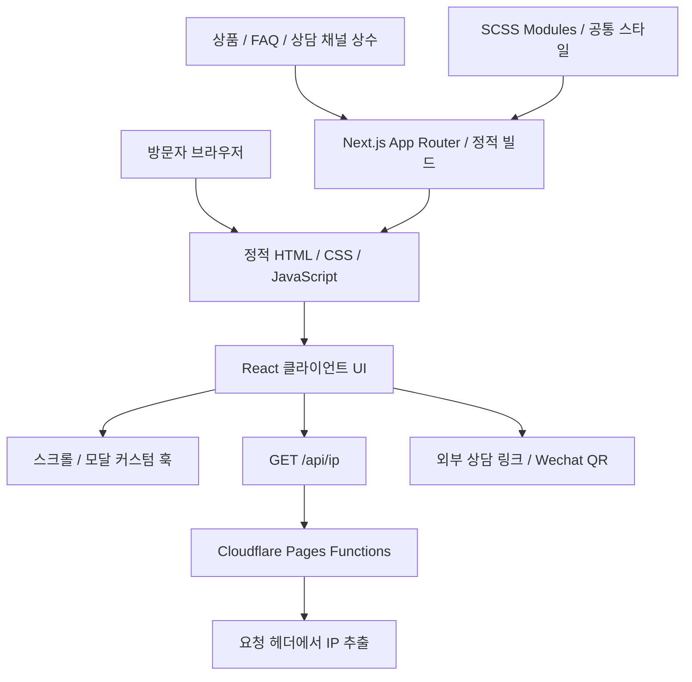

# 기술 설계와 구현 범위

[README](../README.md) · [기능 상세](FEATURES.md) · [코드 참조](SOURCE.md)

## 구성 개요



`next.config.ts`의 `output: "export"`가 정적 출력 방식을 지정함. `functions/api/ip.ts`는 Next.js Route Handler가 아니라 Cloudflare Pages Functions 형식의 요청 핸들러임. 정적 파일 호스팅과 요청 시점에 실행할 IP 처리 코드를 나눈 구성임.

## 디렉터리 역할

```text
src/
├─ app/                  # 4개 경로, 공통 레이아웃, Metadata·JSON-LD
├─ components/
│  ├─ basic/             # 버튼·설명·태그·카드·아코디언 등
│  ├─ expansion/         # 상품 카드·CTA 컨테이너
│  ├─ module/            # 배너·요금·FAQ·모달·장점 등 섹션
│  ├─ layout/            # 메인·임대 PC·요금 화면 조합
│  └─ common/            # 로딩·맨 위 이동
├─ hooks/                # 스크롤·모달 상태와 이벤트 관리
├─ contants/             # 원본 폴더명: 상품·문구·이미지 경로 상수
├─ styles/               # SCSS Modules·공통 토큰·반응형 규칙
├─ types/                # 상품·FAQ·상담 채널 타입
└─ utils/                # IPv6 형태 구분
functions/api/ip.ts      # Cloudflare IP 응답 핸들러
public/                  # 이미지·폰트·기존 화면 캡처
```

## 1. 페이지와 인터랙션의 역할 분리

각 `page.tsx`는 서비스별 Metadata와 JSON-LD를 정의하고 화면 레이아웃 컴포넌트를 불러옴. 상태나 브라우저 이벤트가 필요한 화면 조합·섹션은 클라이언트 컴포넌트로 선언되어 있음.

공통 `layout.tsx`는 헤더·푸터·맨 위 이동 UI와 사이트 수준 메타데이터·JSON-LD를 제공함. VPN과 임대 PC의 내용은 별도 구성하면서 공통 탐색과 스타일을 유지함.

## 2. 타입이 있는 콘텐츠 데이터

상품·PC 사양·질문·연락 수단을 `src/contants/item.ts`의 배열로 관리함. `CardPriceProp`, `RentalPCPriceProp`, `ContactModalProp` 등의 인터페이스가 데이터 형태를 정의함.

같은 `RentalPCPriceItems`를 소개 화면과 요금 화면에서 사용해 데이터 수정 지점을 줄임. VPN·임대 PC FAQ 배열은 화면과 FAQPage JSON-LD 작성에도 사용함. 변경은 소스 수정과 재빌드를 통해 반영하는 구조임.

## 3. 커스텀 훅과 스타일의 분담

커튼 훅은 스크롤 진행률과 덮개의 `scaleX`를 처리함. 콘텐츠 전환 훅은 현재 단계 인덱스를, 내비게이션 훅은 표시 상태를 반환함. SCSS는 Sticky 위치와 불투명도·블러·위치 전환을 담당함.

커튼·콘텐츠 전환에는 `requestAnimationFrame`을 적용해 스크롤 이벤트의 화면 갱신을 조절하고, 콘텐츠 인덱스는 바뀔 때만 React 상태를 갱신함.

## 4. 모달 상태와 이벤트

`useOpenContainer`가 `open`, `containerRef`, 열기 핸들러를 제공함. 모달이 열려 있는 동안 바깥 클릭 이벤트를 등록하고 정리함. 요금 페이지의 상담 모달과 상담 모달 내부의 Wechat QR 모달이 이 훅을 각각 사용함.

별도 상태 관리 라이브러리 없이 `useState`, `useRef`, `useEffect`로 UI 상태를 관리함.

## 5. 정적 출력과 IP 조회

정적 페이지와 달리 방문자 IP는 요청 시점 정보임. 메인 컴포넌트에서 `/api/ip`를 호출하고 Functions는 다음 순서로 값을 읽음.

1. `cf-connecting-ip` 헤더를 확인함.
2. 없으면 `x-forwarded-for`를 사용함.
3. 쉼표로 연결된 값 중 첫 번째 IP를 반환함.

IP 조회 핸들러는 Cloudflare Pages Functions 런타임과 `/api/ip` 라우팅을 갖춘 환경에서 실행됨.

## 6. 검색·공유 정보

`createPageMetadata`는 서비스별 제목·설명·Canonical·Open Graph·Twitter 정보를 구성함. `JsonLd`는 JSON을 직렬화하고 `<`를 이스케이프해 `application/ld+json` 스크립트를 출력함.

- 공통 레이아웃: `Organization`, `WebSite`.
- VPN·임대 PC 소개: `Service`, `FAQPage`.
- 요금 화면: `OfferCatalog`, `Offer`, 제공 서비스 정보.
- `sitemap.ts`: 4개 서비스 경로.
- `robots.ts`: 크롤링 허용과 사이트맵 주소.
