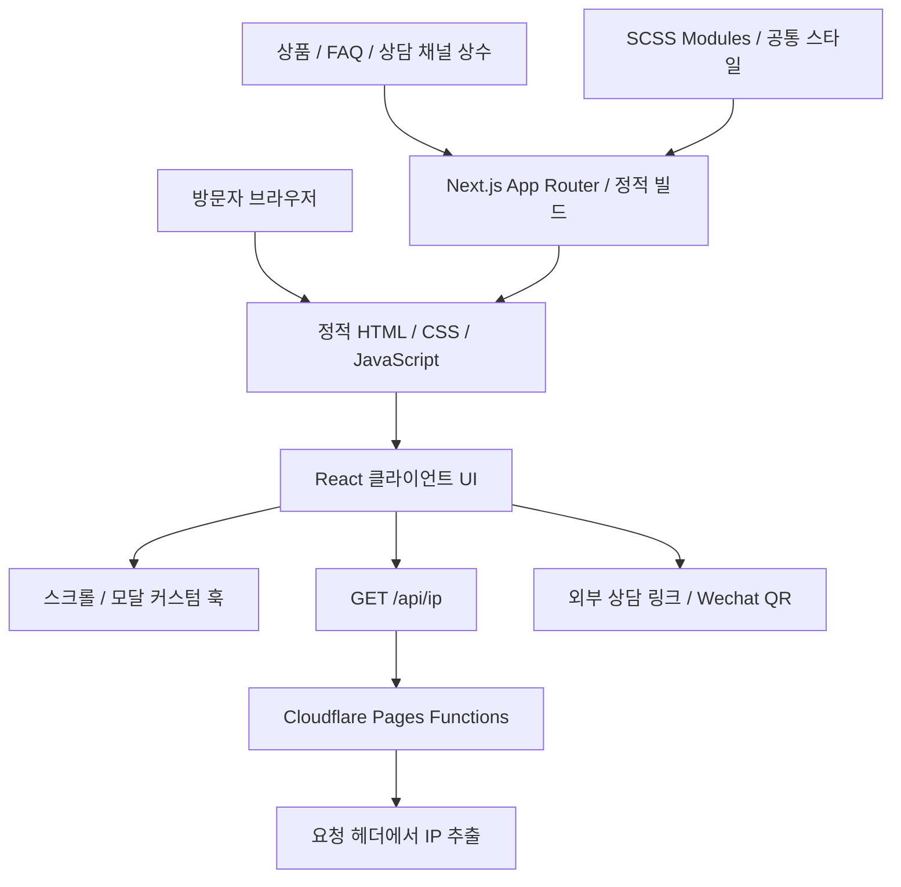

# 기술 설계와 구현 범위

[README](../README.md) · [기능 상세](FEATURES.md) · [코드 출처](SOURCE.md)

## 구성 개요



`next.config.ts`의 `output: "export"`가 정적 출력 방식을 지정합니다. `functions/api/ip.ts`는 Next.js Route Handler가 아니라 Cloudflare Pages Functions 형식의 요청 핸들러입니다. 정적 파일 호스팅과 요청 시점에 실행할 IP 처리 코드를 나눈 구성입니다.

배포 설정 파일이나 운영 배포 로그는 확인하지 않았으므로 실제 호스팅 연결 상태를 검증한 것으로 해석하지 않습니다.

## 디렉터리 역할

```text
src/
├─ app/                  # 4개 경로, 공통 레이아웃, Metadata·JSON-LD
├─ components/
│  ├─ basic/             # 버튼·설명·태그·카드·아코디언 등
│  ├─ expansion/         # 상품 카드·CTA 컨테이너
│  ├─ module/            # 배너·요금·FAQ·모달·장점 등 섹션
│  ├─ layout/            # 메인·임대 PC·요금 화면 조합
│  └─ common/            # 로딩·맨 위 이동
├─ hooks/                # 스크롤·모달 상태와 이벤트 관리
├─ contants/             # 원본 폴더명: 상품·문구·이미지 경로 상수
├─ styles/               # SCSS Modules·공통 토큰·반응형 규칙
├─ types/                # 상품·FAQ·상담 채널 타입
└─ utils/                # IPv6 형태 구분
functions/api/ip.ts      # Cloudflare IP 응답 핸들러
public/                  # 이미지·폰트·기존 화면 캡처
```

## 1. 페이지와 인터랙션의 역할 분리

각 `page.tsx`는 서비스별 Metadata와 JSON-LD를 정의하고 화면 레이아웃 컴포넌트를 불러옵니다. 상태나 브라우저 이벤트가 필요한 화면 조합·섹션은 클라이언트 컴포넌트로 선언되어 있습니다.

공통 `layout.tsx`는 헤더·푸터·맨 위 이동 UI와 사이트 수준 메타데이터·JSON-LD를 제공합니다. VPN과 임대 PC의 내용은 별도 구성하면서 공통 탐색과 스타일을 유지합니다.

## 2. 타입이 있는 콘텐츠 데이터

상품·PC 사양·질문·연락 수단을 `src/contants/item.ts`의 배열로 관리합니다. `CardPriceProp`, `RentalPCPriceProp`, `ContactModalProp` 등의 인터페이스가 데이터 형태를 정의합니다.

같은 `RentalPCPriceItems`를 소개 화면과 요금 화면에서 사용해 데이터 수정 지점을 줄입니다. VPN·임대 PC FAQ 배열은 화면과 FAQPage JSON-LD 작성에도 사용합니다. 변경은 소스 수정과 재빌드를 통해 반영하는 구조입니다.

## 3. 커스텀 훅과 스타일의 분담

커튼 훅은 스크롤 진행률과 덮개의 `scaleX`를 처리합니다. 콘텐츠 전환 훅은 현재 단계 인덱스를, 내비게이션 훅은 표시 상태를 반환합니다. SCSS는 Sticky 위치와 불투명도·블러·위치 전환을 담당합니다.

커튼·콘텐츠 전환에는 `requestAnimationFrame`을 적용해 스크롤 이벤트의 화면 갱신을 조절하고, 콘텐츠 인덱스는 바뀔 때만 React 상태를 갱신합니다. 내비게이션을 포함한 모든 훅에 같은 최적화가 적용된 것은 아닙니다.

## 4. 모달 상태와 이벤트

`useOpenContainer`가 `open`, `containerRef`, 열기 핸들러를 제공합니다. 모달이 열려 있는 동안 바깥 클릭 이벤트를 등록하고 정리합니다. 요금 페이지의 상담 모달과 상담 모달 내부의 Wechat QR 모달이 이 훅을 각각 사용합니다.

별도 상태 관리 라이브러리 없이 `useState`, `useRef`, `useEffect`로 UI 상태를 관리합니다. 현재 코드의 바깥 클릭 닫기까지를 구현 범위로 보며, Escape 닫기·포커스 트랩 등은 확인한 기능으로 제시하지 않습니다.

## 5. 정적 출력과 IP 조회

정적 페이지와 달리 방문자 IP는 요청 시점 정보입니다. 메인 컴포넌트에서 `/api/ip`를 호출하고 Functions는 다음 순서로 값을 읽습니다.

1. `cf-connecting-ip` 헤더를 확인합니다.
2. 없으면 `x-forwarded-for`를 사용합니다.
3. 쉼표로 연결된 값 중 첫 번째 IP를 반환합니다.

`next dev`만 실행하거나 정적 출력만 제공하는 호스트에서는 이 Functions 핸들러가 함께 실행되지 않습니다. IP 확인은 해당 런타임과 라우팅을 갖춘 환경에서 별도 검증해야 합니다. 현재 UI의 요청 실패 처리와 IP 보안 상태 판단은 개선 여지가 있습니다.

## 6. 검색·공유 정보

`createPageMetadata`는 서비스별 제목·설명·Canonical·Open Graph·Twitter 정보를 구성합니다. `JsonLd`는 JSON을 직렬화하고 `<`를 이스케이프해 `application/ld+json` 스크립트를 출력합니다.

- 공통 레이아웃: `Organization`, `WebSite`.
- VPN·임대 PC 소개: `Service`, `FAQPage`.
- 요금 화면: `OfferCatalog`, `Offer`, 제공 서비스 정보.
- `sitemap.ts`: 4개 서비스 경로.
- `robots.ts`: 크롤링 허용과 사이트맵 주소.

화면의 `soldOut`과 별개로 요금 구조화 데이터의 `availability`는 현재 모두 `InStock`으로 작성되어 있습니다. 재고 상태까지 일관되게 연동한 기능으로 설명하지 않습니다.

## 제약과 후속 개선 지점

| 항목 | 현재 확인한 범위 | 후속 개선 방향 |
| --- | --- | --- |
| IP 표시 | 헤더 값 표시, IPv6 형태에 따른 문구 전환 | 오류·로딩 상태, 주소 형태와 보호 상태 표현 분리 |
| 접근성 | 일부 시맨틱 태그·질문 버튼·이미지 설명 | 모달 포커스·Escape, 아코디언 ARIA, 키보드 탐색 검증 |
| 모션 | 스크롤·반복 애니메이션 | 모션 감소 설정 대응과 실기기 동작 점검 |
| 상품 상태 | 정적 배열의 품절 오버레이 | 구조화 데이터 일치, 실시간 연동 필요 여부 검토 |
| 성능 | 정적 출력, WebP 자산, 일부 rAF 갱신 | Lighthouse·실사용 지표와 모바일 스크롤 측정 |
| 이미지 | `next/image` 사용, `images.unoptimized: true` | 자산 크기와 반응형 전달 방식 검토 |

위 내용은 공개 포트폴리오의 정확한 구현 범위를 위한 기록이며, 원본 애플리케이션 수정은 수행하지 않았습니다.
