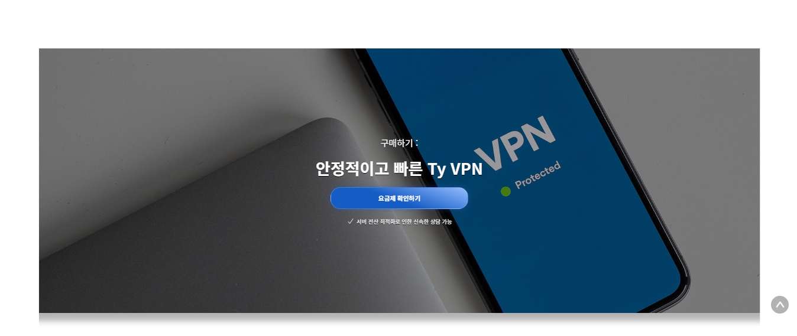
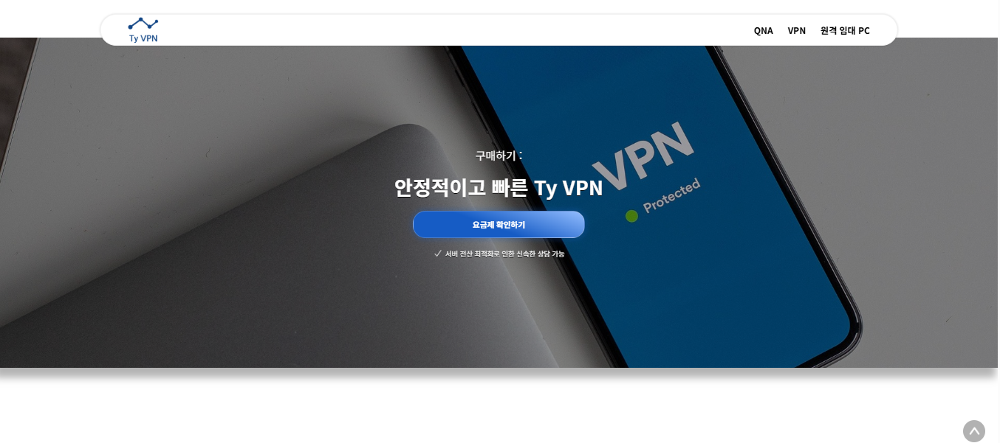
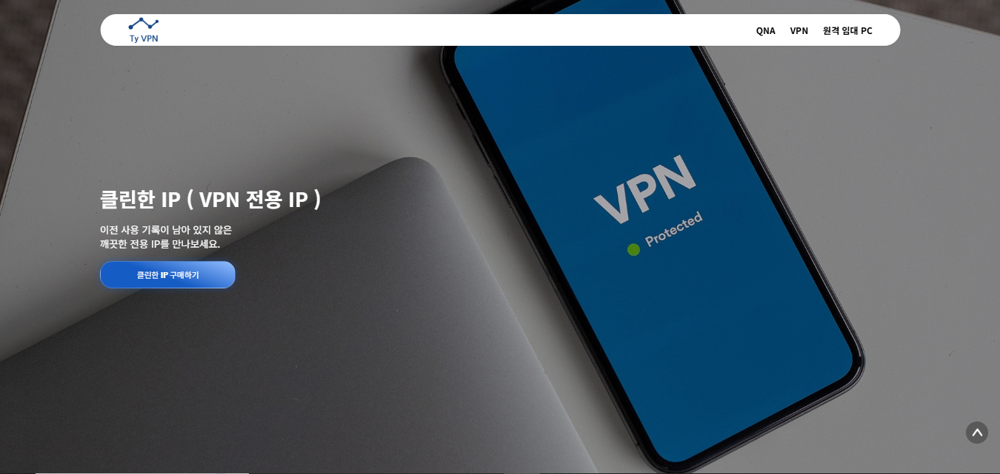
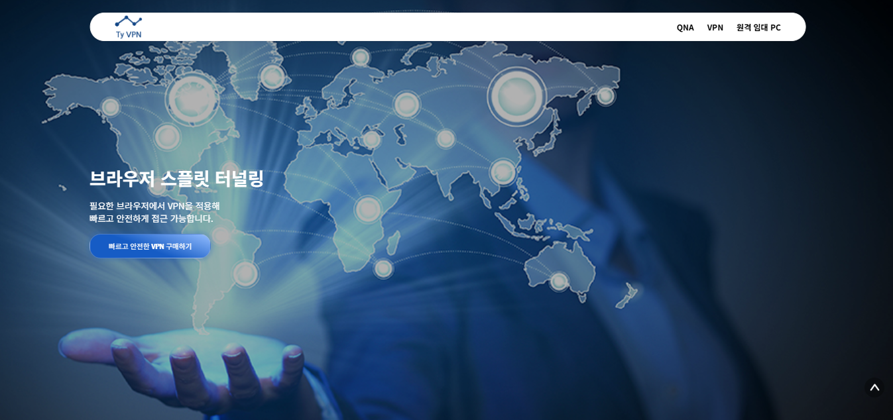
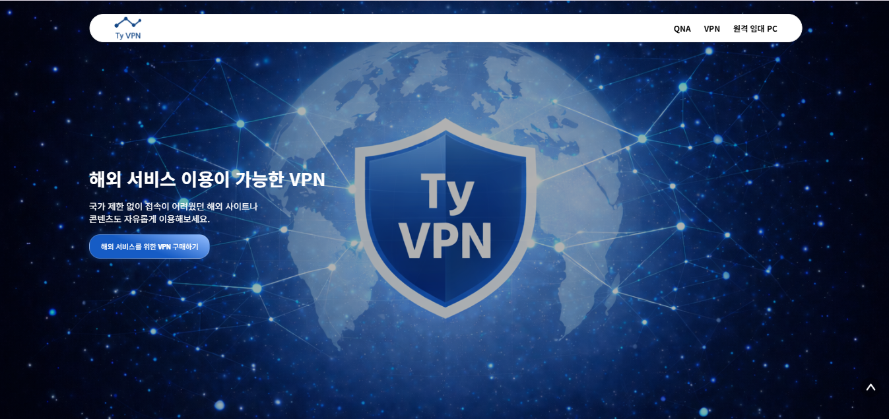
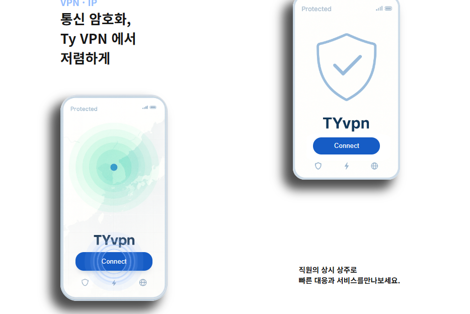

# 인터랙션과 시각 효과

[README](../README.md) · [화면 갤러리](SCREENS.md)

## 효과 목록

| 효과 | 적용 위치 | 구현 방식 | 전달하려는 경험 |
| --- | --- | --- | --- |
| 내비게이션 표시·숨김 | 공통 헤더 | 스크롤 위치·방향으로 클래스 변경, `top`·`opacity` transition | 스크롤 상태에 따른 탐색 UI 변화 |
| 파동·점멸 | VPN 소개의 모바일 기기 그래픽 | `wavebtn`, `ripple`, `hideText` CSS keyframes | 서비스 소개 이미지에 움직임 부여 |
| 좌우 커튼 개방 | VPN 중간 요금 CTA | 좌·우 덮개를 각 바깥쪽 기준으로 `scaleX` 축소 | 배경과 요금 CTA를 스크롤에 맞춰 노출 |
| Sticky 요약 | VPN 장점 영역 | 장점 카드 옆 요약 패널에 `position: sticky` 적용 | 장점 목록을 읽는 동안 핵심 요약 유지 |
| 3단계 콘텐츠 전환 | VPN 하단 서비스 소개 | 스크롤 진행률로 활성 인덱스 계산, `opacity`·`filter` transition | 이미지·설명·CTA를 단계별로 전달 |
| Sticky PC 소개 | 임대 PC 사양 목록 | 설명 영역을 고정하고 사양 카드를 아래로 나열 | 상품 목록을 읽는 동안 소개 맥락 유지 |
| 아코디언 | VPN·임대 PC FAQ | 문항별 boolean 상태, 답변·화살표 클래스 전환 | 필요한 답변을 선택해 열기·닫기 |
| 상담 모달 | 요금 페이지 | 조건부 렌더링, 영역 밖 클릭 감지, Wechat 중첩 모달 | 가격 확인 후 상담 수단 선택 |
| 맨 위 이동 | 공통 화면 | `window.scrollTo`와 `behavior: "smooth"` | 긴 페이지 상단으로 복귀 |

## 1. 커튼 효과의 스크롤 연동

`Contact`에서 `useScrollCurtain`의 좌·우 ref를 덮개에 연결함. 훅은 섹션의 위치와 높이, 뷰포트 높이로 진행률을 계산하고 `0~1`로 제한함.

```text
progress = clamp((scrollY + viewportHeight - sectionTop) / sectionHeight, 0, 1)
scale = 1 - progress
```

왼쪽 덮개는 `transform-origin: left center`, 오른쪽 덮개는 `right center`로 설정함. 스크롤할수록 양쪽 덮개가 줄어들어 중앙의 배경 이미지와 요금 버튼이 드러남.

스크롤 리스너는 `passive: true`로 등록하고 `requestAnimationFrame`으로 갱신을 예약함. 리사이즈에서 치수를 다시 계산하고, 언마운트 시 이벤트와 예약 프레임을 정리함.





## 2. Sticky와 콘텐츠 전환

`MeritPoint`는 장점 카드와 Sticky 요약을 함께 보여줌. 별도 스크롤 인덱스 계산 없이 CSS Sticky로 요약 영역의 위치를 유지함.

`ChangedSticky`는 높이 `300vh`의 섹션에 3개 콘텐츠를 배치하고, 각 콘텐츠의 표시 영역을 `100vh`로 구성함. `useScrollChangeContainer`가 섹션 내 진행률을 콘텐츠 개수에 대응시켜 활성 인덱스를 `0~2`로 제한함.

활성 콘텐츠에는 `active` 클래스를 적용해 불투명도를 높이고 블러를 제거함. 각 콘텐츠가 해당 이미지·설명·요금 CTA를 함께 가지고 있어 단계가 바뀔 때 메시지도 함께 전환됨.







## 3. 내비게이션 상태

`useScrollHideView`의 현재 로직은 최상단에서 메뉴를 표시하고, 아래로 스크롤해 뷰포트 높이의 10%를 넘으면 표시 상태를 설정함. 위로 스크롤하면 숨김 상태를 설정함. 클래스 `nav_on`과 `nav_off`가 위치와 투명도를 전환함.

## 4. 소개 애니메이션과 클릭 효과

모바일 기기 모양의 소개 영역에서 연결 버튼과 원형 파동, 문구의 표시 상태를 CSS keyframes로 반복함. 서비스 소개용 그래픽에 연결 상태를 표현하는 시각 효과를 적용함.

FAQ는 질문별로 답변을 펼치고 화살표 방향을 변경함. 상담 모달은 구매 버튼으로 열고, 모달 바깥 클릭으로 닫음. Wechat 선택 시 QR 이미지를 추가로 표시함.


