# 웹페이지 화면 갤러리

[README](../README.md) · [기능 상세](FEATURES.md) · [인터랙션 효과](INTERACTIONS.md)

원본 저장소 `public/readme/`에 있던 **19개 PNG**를 페이지와 영역별로 정리했습니다. 새로 촬영한 화면이 아니며 촬영일·실행 버전은 확인되지 않았습니다. 이미지의 가격·상품 상태·문구는 촬영 시점의 예시입니다. 정지 이미지에 보이지 않는 클릭 동작은 코드에서 확인한 내용을 설명합니다.

## 화면 목록

| 페이지·영역 | 이미지 수 | 보여주는 내용 |
| --- | ---: | --- |
| 공통 내비게이션·IP 바 | 2 | 탐색 메뉴, IP 표시 영역 |
| VPN 메인 | 10 | 히어로, 소개, 커튼 CTA 2장, 장점 2장, 전환 콘텐츠 3장, FAQ |
| 원격 임대 PC | 5 | 히어로, 교차 소개, 사양 목록 2장, FAQ |
| VPN 요금 | 1 | 상품 카드, 가격, 추천 표시 |
| 원격 임대 PC 요금 | 1 | 월 요금, 사양, 품절 표시 |

## 공통 UI

### 01. 내비게이션

로고, QNA 앵커, VPN, 원격 임대 PC 이동 메뉴입니다. 흰색의 둥근 메뉴 바를 공통 헤더에 배치합니다. 스크롤에 따라 위치와 투명도를 전환합니다.

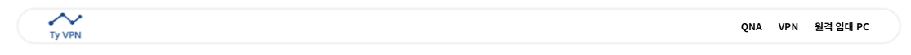

### 02. IP 바

VPN 메인 상단의 IP 표시 영역입니다. `/api/ip` 응답을 표시하며, 원본 이미지의 IP 일부는 이미 가려져 있습니다. 실제 VPN 보호 상태를 확인하는 기능은 아닙니다.

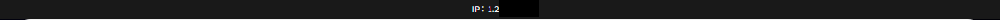

## VPN 메인 · `/`

### 03. 히어로 배너

대형 지구 이미지 옆에 서비스 소개와 주요 안내, 요금제 확인 버튼을 배치합니다. 첫 화면에서 서비스의 성격과 다음 이동 지점을 제시합니다.

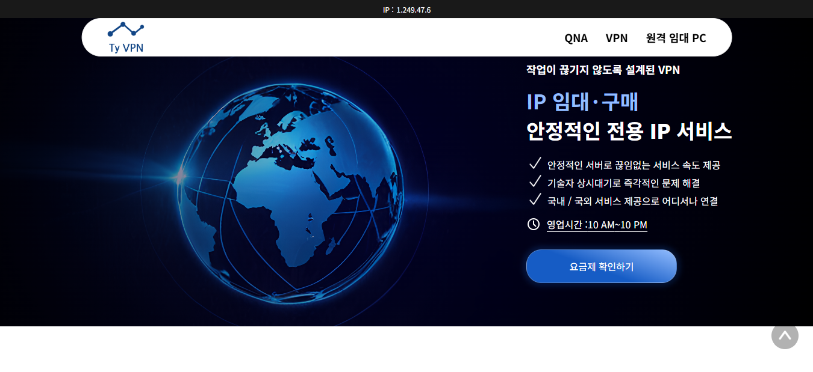

### 04. 소개와 CSS 애니메이션

모바일 기기 형태의 그래픽과 설명을 교차 배치합니다. 연결 버튼 주변 파동과 문구 점멸은 CSS 애니메이션이며 실제 연결 동작은 아닙니다.

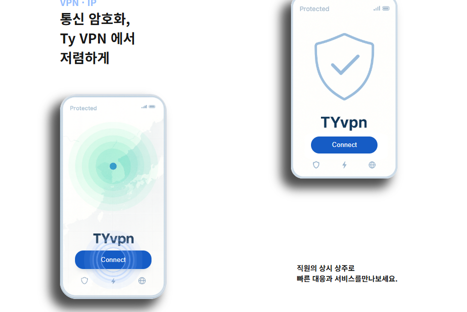

### 05. 커튼 CTA · 전개 중

스크롤에 따라 좌우 덮개가 줄어들면서 배경 이미지와 요금 버튼을 노출합니다.

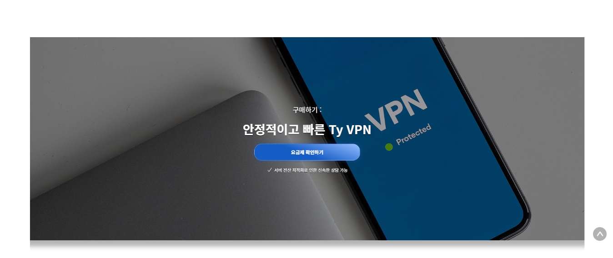

### 06. 커튼 CTA · 전개 후

덮개가 열린 상태에서 요금제 확인 버튼을 중심에 보여줍니다. 클릭 시 VPN 요금 페이지로 이동합니다.

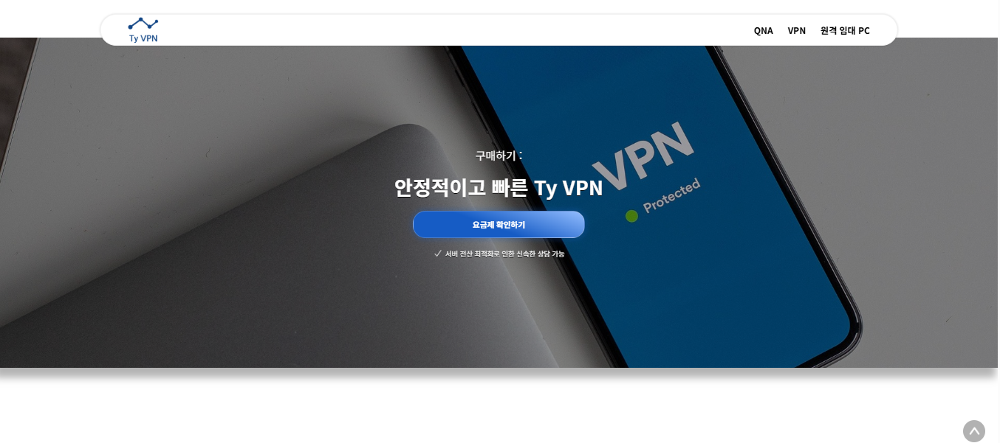

### 07. 장점 카드와 Sticky 요약 · 상단

서비스 장점을 카드와 태그로 정리하고 옆에 요약 패널을 배치합니다. 요약은 섹션 내 스크롤에서 Sticky로 유지됩니다.

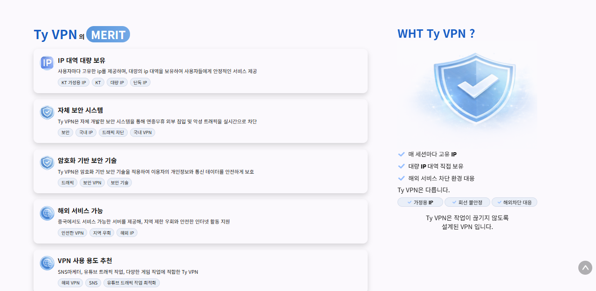

### 08. 장점 카드와 Sticky 요약 · 하단

카드 목록의 하단을 읽을 때도 요약이 함께 보이는 구성입니다. 캡처의 `WHT` 문구는 기준 소스에서 `WHY`로 수정되어 있습니다.

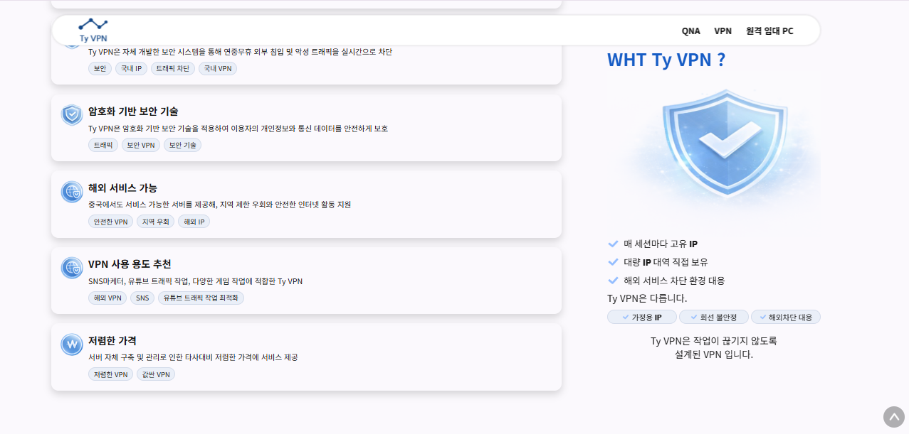

### 09. 스크롤 콘텐츠 · 클린 IP

화면 크기의 배경 위에 제목·설명·버튼을 배치합니다. 스크롤 진행률에 따라 활성 콘텐츠를 바꿉니다.

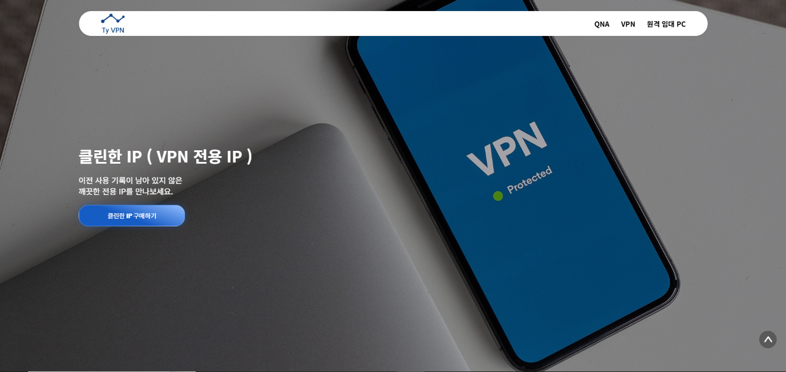

### 10. 스크롤 콘텐츠 · 브라우저 이용 안내

다음 스크롤 구간에서 배경과 설명, 버튼 문구를 함께 전환합니다. 스플릿 터널링은 소개 문구로, 웹에서 직접 실행하는 기능은 아닙니다.

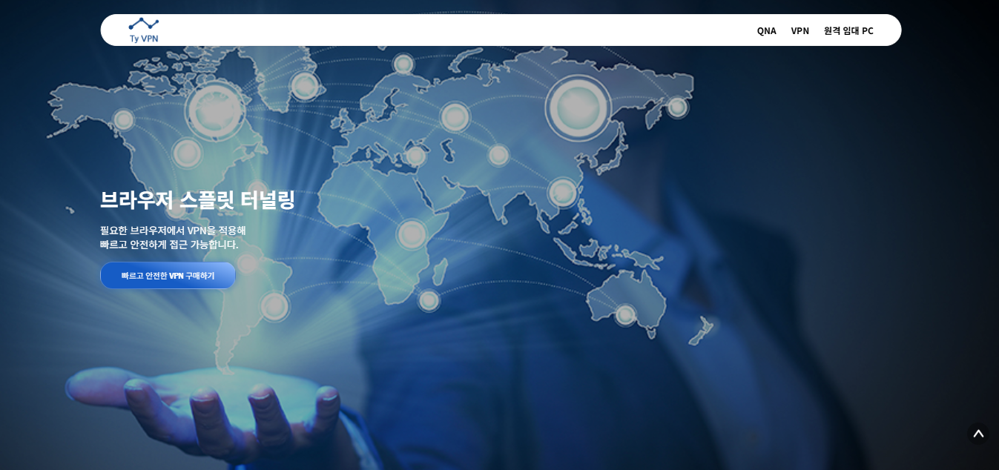

### 11. 스크롤 콘텐츠 · 해외 서비스 안내

세 번째 콘텐츠에서 해외 서비스 안내와 VPN 요금 페이지로 이어지는 CTA를 보여줍니다.

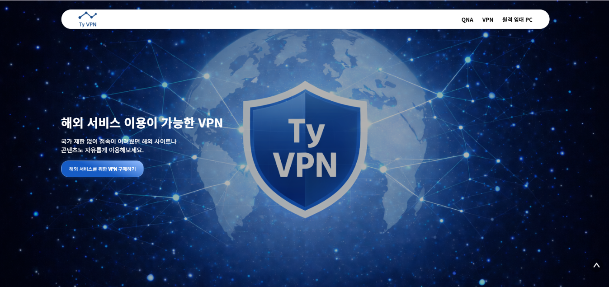

### 12. VPN FAQ

구매·연장·기기 연결·교체 등 질문을 나열합니다. 소스의 12개 문항 중 일부가 보이는 캡처이며, 클릭 시 개별 답변을 펼칩니다.

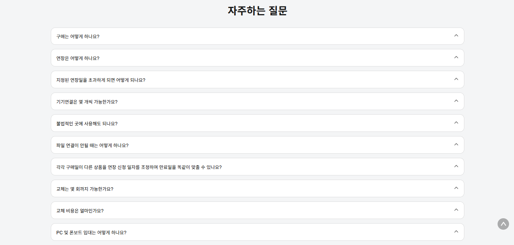

## 원격 임대 PC · `/Rental-PC`

### 13. 히어로 배너

서버·PC 이미지를 배경으로 임대 서비스를 소개하고 요금제 확인 버튼을 제공합니다.

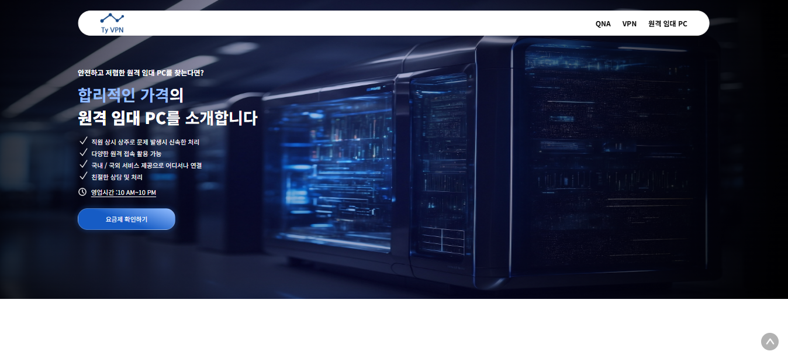

### 14. 이미지·텍스트 교차 소개

이미지와 설명의 좌우 순서를 바꿔 배치해 긴 소개 화면의 흐름에 변화를 줍니다.

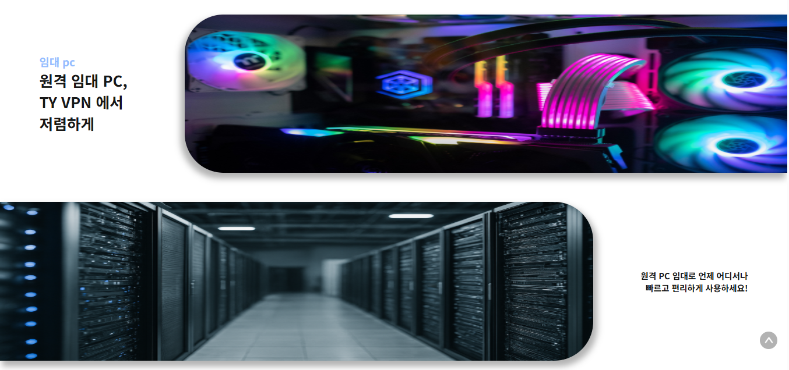

### 15. 사양 카드 · 목록 상단

소개 문구 옆에 CPU·GPU·RAM·SSD·월 요금을 카드로 보여줍니다. 품절된 구성에는 오버레이를 적용합니다.

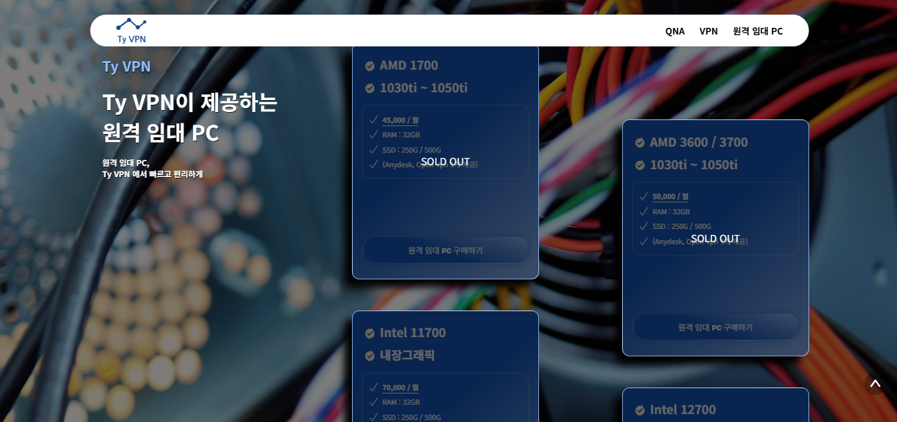

### 16. 사양 카드 · 목록 하단

스크롤 후반의 상품 카드입니다. 소개 문구를 Sticky로 유지하면서 다른 사양을 확인하도록 구성했습니다.

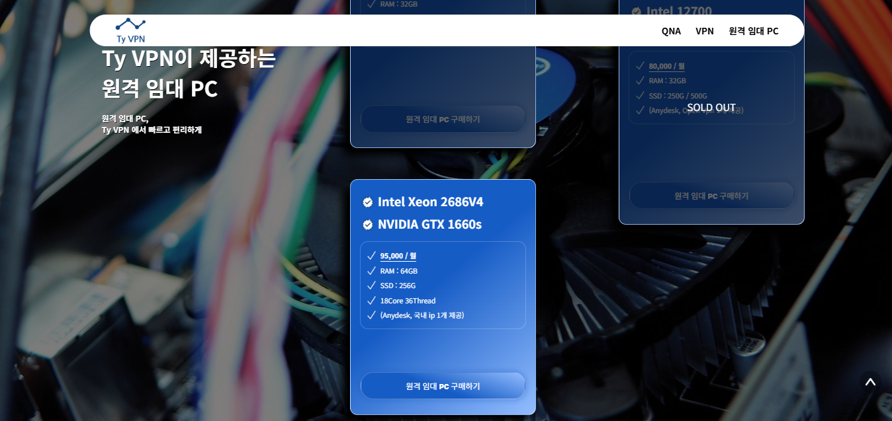

### 17. 원격 임대 PC FAQ

임대 기간, 데이터, 접속, 환불 등 8개 질문을 보여줍니다. VPN FAQ와 같은 아코디언 컴포넌트를 재사용합니다.

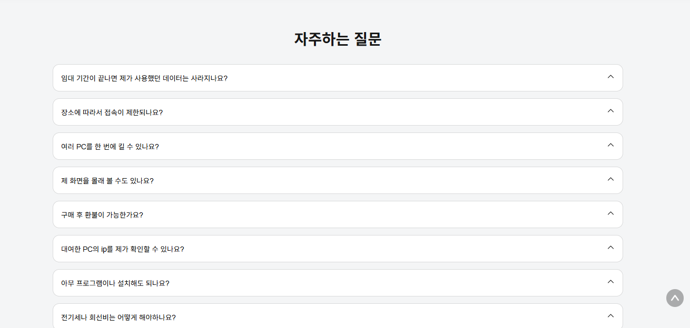

## 요금 페이지

### 18. VPN 요금 · `/price/vpn`

3개 상품을 나란히 배치하고 가격·제공 항목·구매 버튼을 보여줍니다. 추천 상품에 `BEST SELLER` 스타일을 적용하며, 구매 버튼은 상담 채널 모달을 엽니다.

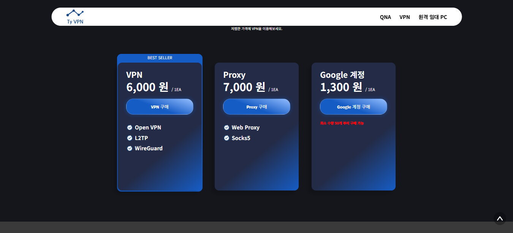

### 19. 임대 PC 요금 · `/price/rental-pc`

5개 사양의 월 요금과 제공 조건을 비교합니다. 품절 오버레이는 원본 데이터의 상태를 표시하며 실시간 재고 연동은 아닙니다. 캡처는 페이지 중간 영역입니다.

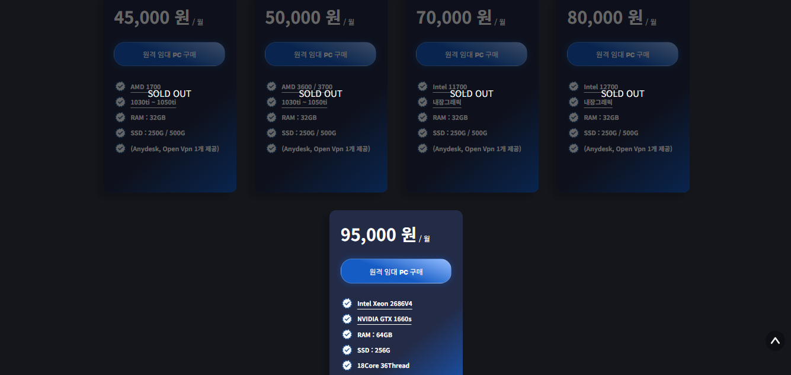

## 화면 자료의 범위

기존 캡처에는 상담 모달·Wechat QR·FAQ를 펼친 상태·모바일 화면이 포함되어 있지 않습니다. 이들 기능은 코드 근거로 설명했으며, 새 실행 화면이나 동영상으로 제시하지 않습니다.

이미지 원본 경로와 해시는 [출처 문서](SOURCE.md), [이미지 목록](../assets/screenshots/manifest.json)에서 확인할 수 있습니다.
